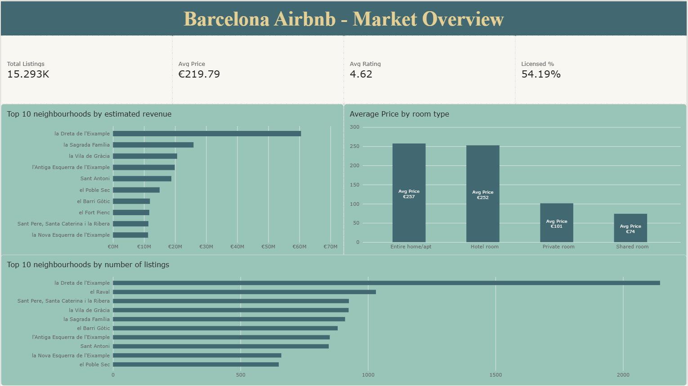
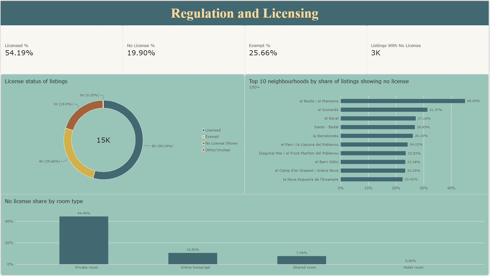
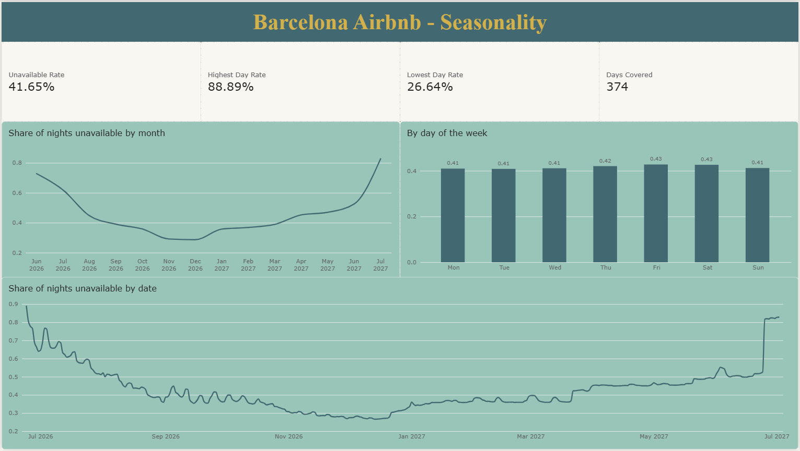

# Barcelona Airbnb Market Analysis: Databricks + Power BI

An end-to-end analytics project on Inside Airbnb's Barcelona data: raw files are cleaned and modelled on Databricks (bronze, silver, gold), checked with data quality tests, and presented in a 3-page Power BI report covering the market, regulation and licensing, and seasonality.

## Business framing

Imagine a host management company deciding where to invest and how to price listings in Barcelona. The project answers four questions:

1. Which neighbourhoods have the best revenue potential?
2. How does price vary by room type?
3. How many listings show a license, and where are the gaps? (Barcelona regulates short-term rentals.)
4. Is there seasonality in demand?

## Data

[Inside Airbnb](http://insideairbnb.com/get-the-data), Barcelona. Check Inside Airbnb's terms before reusing the data.

| File | Rows | Used for |
|---|---:|---|
| `listings.csv` | 15,293 (90 columns) | listing attributes, prices, license text, ratings |
| `calendar.csv` | 5,623,190 | nightly availability for the seasonality page |
| `reviews.csv` | 1,033,523 | loaded and cleaned (HTML tags stripped); not used in the report |

## Tech stack

Databricks (Free Edition), PySpark and Spark SQL, Delta Lake, Unity Catalog, Power BI Desktop (Import mode).

## Pipeline

```
3 raw CSVs -> BRONZE (raw copy) -> SILVER (cleaned) -> GOLD (star schema) -> Power BI
```

- **Bronze:** the three files loaded as Delta tables with an `_ingested_at` column. Row counts were reconciled against the source.
- **Silver:** prices, percentages and `t`/`f` flags converted to proper types; the license text parsed into categories; the 90 raw listing columns reduced to about 30 analysis columns; HTML removed from review comments.
- **Gold:** `fact_listings` (one row per listing, with a `price_outlier` flag), `dim_host` (4,595 hosts), `dim_neighbourhood` (69 neighbourhoods) and `daily_occupancy` (one row per calendar date, so 5.6M calendar rows become a dashboard-sized table).

## Data quality checks

Row counts across layers, duplicate listing IDs, referential integrity (every listing has a matching host and neighbourhood), null checks on key columns, and a price sanity check. All passed. Interesting findings along the way:

| Issue | What I found | What I did |
|---|---|---|
| License field | Messy, multi-valued text with embedded HTML tags | Parsed with pattern matching into Licensed, Exempt, No License Shown and Other. My first pattern left 482 listings unclassified; I inspected a sample and added the missing registration formats, leaving 38 (0.25%) |
| Missing prices | 1,938 listings (12.7%) have no price, and 1,858 of them are marked available, so they are not simply inactive | Treated as scraping gaps and excluded from price averages |
| Price outliers | 124 listings (0.81%) were under €15 or over €2,000 per night. The 98 high-end listings come from only 10 hosts and are mostly 16-guest properties | Flagged with `price_outlier` instead of deleting. The average price falls from about €240.62 to **€219.79** when they are excluded |

## Dashboard

Power BI, connected to the gold tables.

**1. Market Overview.** 15,293 listings, average price €219.79, average rating 4.62, 54.19% showing a license. Estimated revenue is concentrated in la Dreta de l'Eixample (about €60M), well ahead of la Sagrada Família (about €26M). Average price is about €257 for entire homes, €252 for hotel rooms, €101 for private rooms and €74 for shared rooms. el Raval has the second-highest number of listings (1,031) but is outside the top 10 by estimated revenue, which suggests lower revenue per listing (a hypothesis to test).


**2. Regulation and Licensing.** Of all listings, 54.19% show a license number, 25.66% are exempt (for example hostels and seasonal rentals), 19.90% show no license and 0.25% are unclear. Private rooms show no license far more often (44.46%) than entire homes (10.50%). Among neighbourhoods with 100 or more listings, el Besòs i el Maresme has the highest share showing no license (45.00%), followed by el Guinardó (31.37%) and el Raval (27.16%). "No License Shown" means no license number appears in the data, not that a listing is unlicensed.


**3. Seasonality.** The share of nights unavailable is lowest in late autumn and winter (roughly 30%) and rises through spring. Weekday and weekend rates differ by only about two percentage points. The calendar is a snapshot of future availability, and its first and last days cover only some listings, so the page uses dates covered by all listings (2026-07-03 to 2027-06-23).


## Limitations

- Estimated revenue and occupancy columns are Inside Airbnb's modelled estimates, not actual bookings.
- The calendar cannot distinguish booked nights from nights blocked by hosts, so the report says "unavailable", not "occupied". Nights close to the scrape date look fuller than distant ones.
- The calendar and listings snapshots differ slightly in listing count; seasonality rates use calendar rows only.
- License categories come from text patterns, and I did not verify them against the official register.
- Reviews were cleaned but not analysed. Findings describe patterns in the data and make no causal claims.

## Repository structure

```
notebooks/    Databricks notebooks (airbnb_01_explore_raw to airbnb_05_data_quality)
dashboard/    Power BI report (.pbix)
screenshots/  dashboard pages
```

## How to reproduce

1. Download the Barcelona `listings`, `calendar` and `reviews` files from Inside Airbnb.
2. In Databricks, create a catalog (`airbnb_barcelona_project`) and a volume, and upload the three files.
3. Import the notebooks and run them in order: explore, bronze, silver, gold, data quality.
4. Open `dashboard/airbnb.pbix` and point it at your own Databricks SQL warehouse (server hostname and HTTP path from the warehouse's connection details).

## What I would do next

- Analyse the multilingual review text (topics and sentiment) against price and license status.
- Compare several scrape dates to measure how availability and prices change.
- Schedule the notebooks as a Databricks Workflow with data quality gates.

---
Built by Kartheek Bhimavarapu
